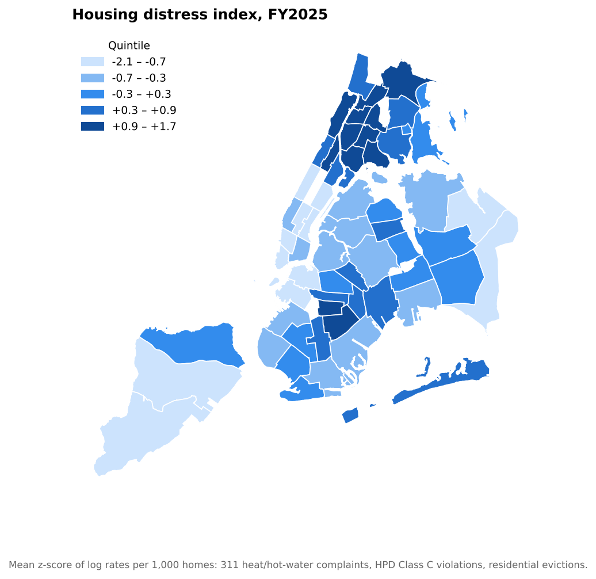
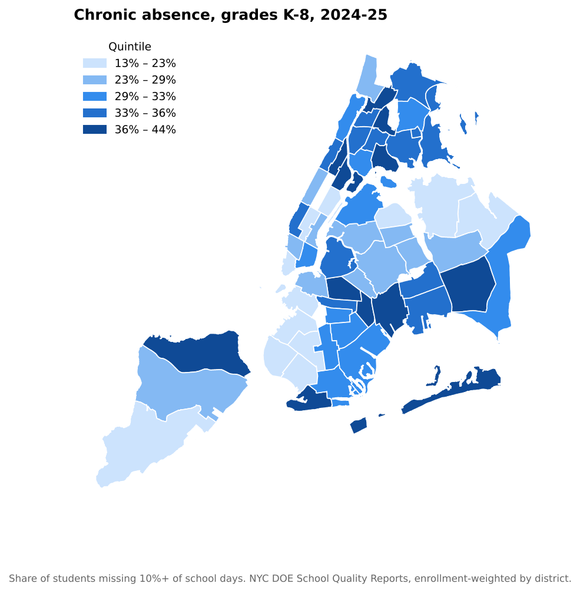
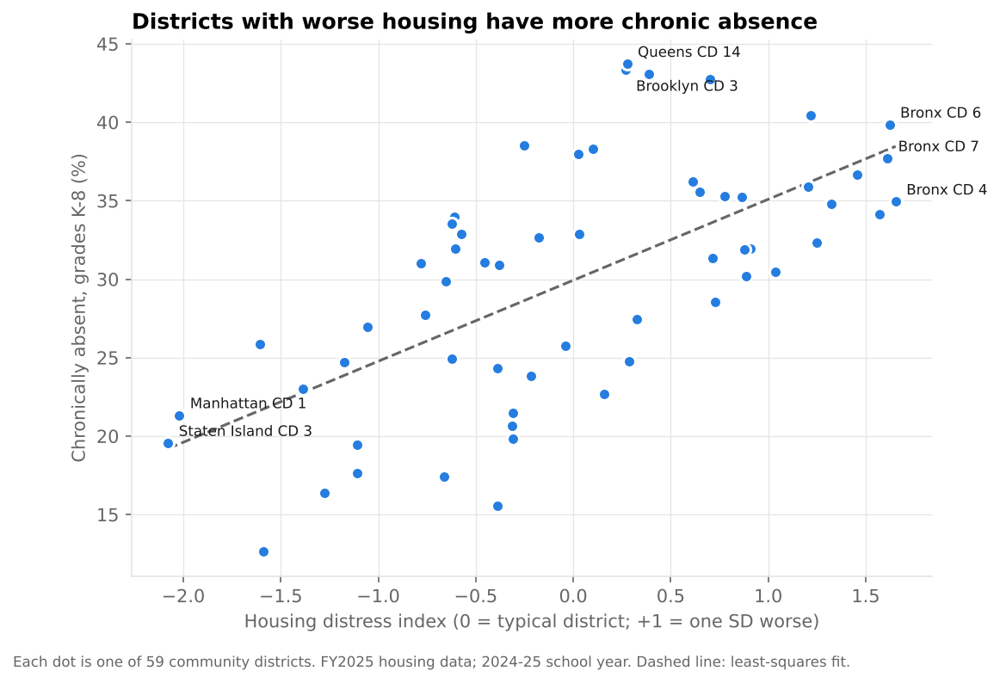
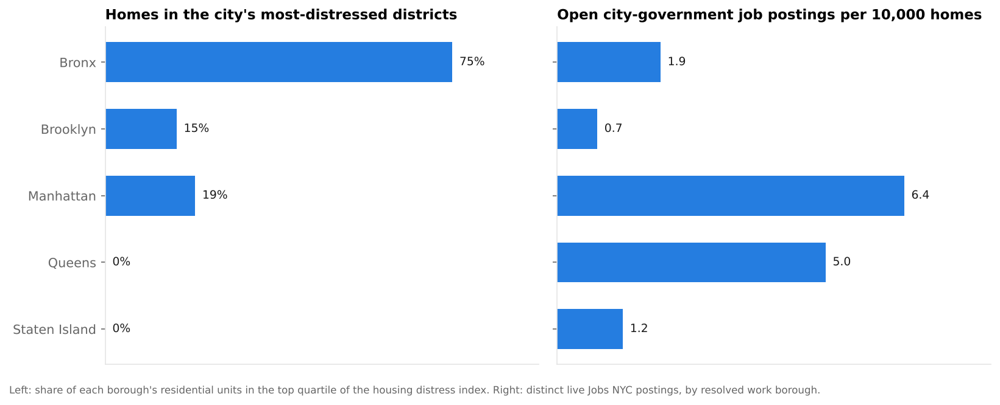

# State of NYC: Housing, Schools & City Jobs by Community District

[](https://github.com/jarvissimms12/state-of-nyc/actions/workflows/tests.yml)


How housing conditions, public schools and city-government hiring line up across
NYC's 59 community districts, built entirely from public NYC Open Data. Every
measure covers the same twelve months: **fiscal year 2025 (July 2024 – June 2025),
which is also the 2024-25 school year.**

**Author:** Jarvis Simms · MS Data Science, NYIT · [LinkedIn](https://www.linkedin.com/in/jarvis-simms-846062136/) · [GitHub](https://github.com/jarvissimms12)

| | |
|---|---|
|  |  |

## Key findings

**1. Housing distress is concentrated, and it's in the Bronx.** The 10 most-distressed
districts hold **14%** of the city's homes but **43%** of its Class C ("immediately
hazardous") HPD violations. Seven of the ten are in the Bronx, and **75%** of Bronx
homes sit in the city's top quartile for housing distress. Per 1,000 homes, the
Bronx logged **180** heat/hot-water complaints and **198** Class C violations in
FY2025, against **18** and **25** on Staten Island.

**2. Those districts have more chronically absent students.** Across districts,
the housing distress index and K-8 chronic absence move together (Spearman
ρ = **0.65**). Citywide, **30.0%** of K-8 students were chronically absent
(missed 10%+ of school days) in 2024-25; in East Tremont/Belmont (Bronx CD 6) it
was **39.8%**.



**3. But the link runs through students, not buildings.** School-level models
(1,287 elementary and middle schools, standard errors clustered by district):

| Predictor of a school's chronic absence | Effect | 95% CI | p |
|---|---|---|---|
| Neighborhood housing distress, alone (per 1 SD) | +5.2 pts | +3.9 to +6.4 | <0.001 |
| Neighborhood housing distress, *controlling for school Economic Need Index* | −0.4 pts | −2.6 to +1.8 | 0.71 |
| School's share of students in temporary housing (per 10 pts), *controlling for ENI* | **+3.4 pts** | +0.4 to +6.4 | 0.03 |

Once a school's poverty level is known, the condition of the surrounding buildings
predicts nothing more. What still predicts absence is how many of the school's
**own students are homeless or doubled up** (2020-21 count, 1,044 schools). For
policy, that points toward students in temporary housing more than toward
neighborhood code enforcement.

**4. Some districts have far more absence than poverty explains.** Compared with what
their schools' economic need predicts, K-8 chronic absence runs **+12 points** high
in the Rockaways (Queens CD 14), **+11** in Bedford-Stuyvesant (Brooklyn CD 3),
**+9** in Jamaica/St. Albans (Queens CD 12) and **+8** in East Harlem and Brownsville.
These are the places where something beyond poverty, such as transit, shelter
placements or school-level factors, deserves a closer look.

**5. City hiring isn't where the housing strain is.** Of 1,382 open Jobs NYC
postings (snapshot Nov 24, 2026; **92.5%** resolved to a work borough), Manhattan
has **6.4 postings per 10,000 homes** and Queens 5.0, against **1.9 in the Bronx**
and 0.7 in Brooklyn. Bronx postings also pay less: a median posted salary of
**$72,945** vs. **$86,583** in Manhattan.



**Data-quality finding:** the Citywide Payroll dataset codes **100% of the
~96,000 DOE teachers and ~25,000 paraprofessionals** to Manhattan. Its
"work location borough" reflects administrative coding, not where people work,
so this project uses payroll only for headcount and pay, never for geography.

## Interactive dashboard

```bash
streamlit run app.py
```

Choropleth map with eight selectable measures, the housing–schools models, city
job postings filterable by borough, and a profile page for every district with
its schools. The app reads only the committed files in `data/processed/`, so it
deploys to Streamlit Community Cloud as-is.

## Pipeline

```
NYC Open Data (SODA API)
  │   heavy aggregation runs server-side with SoQL GROUP BY:
  │   the 11M-row HPD violations and tens-of-millions-row 311 datasets are never downloaded
  ▼
etl/housing.py     311 heat complaints, HPD violations, evictions, PLUTO units   → by district
etl/schools.py     School Quality Reports 2024-25, ENI, temporary housing        → by school & district
etl/jobs.py        Jobs NYC postings (geocoded to borough), FY2025 payroll
etl/geography.py   district boundaries + names
  ▼
build.py           joins → data/processed/*.csv, state_of_nyc.db (SQLite), data_quality.json
  ▼
analysis/run_analysis.py   index, correlations, weighted models, figures → docs/
  ▼
app.py             Streamlit dashboard
```

```bash
pip install -r requirements.txt
python build.py                      # ~5-10 min, all public APIs, no key needed
python analysis/run_analysis.py      # models + figures
pytest -q                            # 32 offline tests
streamlit run app.py
```

A GitHub Actions workflow (`refresh.yml`) re-pulls every source on the 2nd of each
month, reruns the analysis and tests, and commits any changes. An optional
`SODA_APP_TOKEN` repository secret raises API rate limits.

## Decisions that change the answer

- **The chronic absence field is inverted.** In the School Quality Reports,
  `chronic_absent_*` is labeled "Percentage of Students with >90% Attendance". It is
  the share *not* chronically absent. Read as-is, the citywide rate would be 70%,
  not 30%. A test pins this down.
- **K-8, not all grades, for neighborhood comparisons.** High school students
  commute citywide, so a high school's location says little about where its students live.
- **Per residential unit, not per person.** Building conditions scale with homes;
  population would penalize districts with large households.
- **Log rates, then z-scores** for the index, so one skewed measure can't dominate
  (heat complaints range from 6 to 275 per 1,000 homes).
- **Job postings are geocoded conservatively.** Borough or neighborhood names come first,
  then an exact PLUTO tax-lot match (ties broken by building size), then a street name
  that exists in only one borough, then the Queens hyphenated-address rule.
  "100 Gold Street" exists in Brooklyn (8,000 sq ft) and Manhattan (656,000 sq ft,
  the city-owned office building HPD works from), so the Manhattan lot wins. The 103 postings these rules can't place are reported, not guessed.

Full sources, definitions and limitations: [docs/METHODS.md](docs/METHODS.md).
All counts dropped or unmatched at each step: [`data/processed/data_quality.json`](data/processed/data_quality.json).

## Limitations

Association, not causation; districts average ~60,000 homes. School Economic Need
Index (2021-22) and temporary-housing counts (2020-21) are the latest school-level
releases on NYC Open Data, so they lag the outcome year. Small temporary-housing
counts are suppressed. 311 complaints measure reporting as well as conditions. Job
postings cover city government only, as a point-in-time snapshot.

## How this fits with my other projects

| Repo | Role |
|---|---|
| **state-of-nyc** (this repo) | Citywide, district-level hub: housing ↔ schools ↔ jobs |
| [nyc-heat-anomalies](https://github.com/jarvissimms12/nyc-heat-anomalies) | Building-level drill-down: which buildings' heat complaints jumped far above their own history (empirical Bayes + FDR) |
| [nyc-talent-acquisition-analytics](https://github.com/jarvissimms12/DOHMH-Health-Equity) | R/Shiny time-to-fill and EEO reporting workflow (simulated requisition data) |

Next steps: join the heat-anomalies building flags to this district profile; add
HPD litigation and ownership changes (ACRIS); replace the lagged school measures
when DOE publishes newer school-level files.

## Repository layout

```
state-of-nyc/
├── build.py                  # run all ETL, write processed tables
├── app.py                    # Streamlit dashboard
├── src/                      # config, SODA client, geography helpers
├── etl/                      # housing, schools, jobs, geography
├── analysis/run_analysis.py  # index, models, figures
├── data/processed/           # committed outputs (CSV, GeoJSON, JSON)
├── docs/                     # figures, results.json, METHODS.md
├── tests/test_pipeline.py    # offline tests
├── legacy/                   # first version of this repo (borough-level 311 pull)
└── .github/workflows/        # tests on push; monthly data refresh
```
