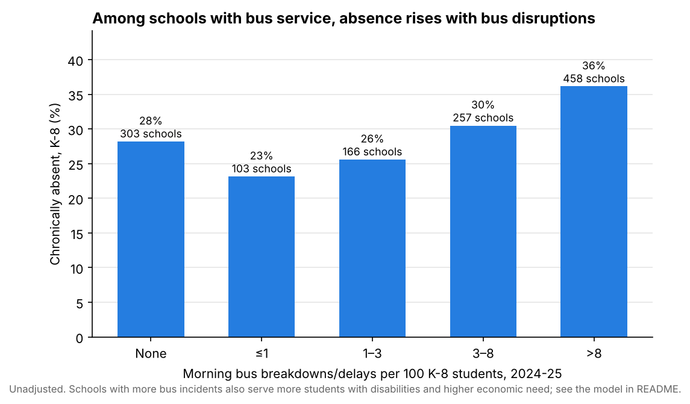

# Study 1 — School bus disruptions and chronic absence

## Summary

| | |
|---|---|
| **Question** | The Rockaways (Queens CD 14) have K-8 chronic absence **~11 points above** what their schools' economic need predicts. Is unreliable school transportation the reason? |
| **Data** | 75,563 school bus breakdowns and delays reported to DOE's Office of Pupil Transportation in 2024-25 (NYC Open Data `ez4e-fazm`), linked to 1,287 elementary and middle schools in the 2024-25 School Quality Reports |
| **Method** | Bus incidents decoded to schools (code `15879` = District 15, school 879 = DBN `15K879`); morning-run incidents per 100 K-8 students; school-level weighted regression controlling for Economic Need Index and share of students with disabilities, errors clustered by community district |
| **Result** | Bus disruption is linked to absence: going from a school at the 25th percentile of bus incidents to one at the 75th is associated with **+4.1 points** of chronic absence (p < 0.001). The Rockaways **do** get worse bus service: **14.7** morning incidents per 100 students vs **8.4** elsewhere, and delays averaging **66 minutes vs 44**. But controlling for buses shrinks the Rockaways' gap only from **+10.7 to +10.4 points**. |
| **Takeaway** | Buses are part of the story citywide but not the Rockaways' story. Something else (geography, distance to schools, shelter placements, school-level factors) drives most of that gap. |



## Details

**Linking incidents to schools.** `schools_serviced` lists the schools a bus run serves
as 5-digit codes. The first two digits are the geographic district and the last three
the school number, which matches a DBN once the borough letter is dropped. An incident
serving several schools counts for each. Of school-age incident-school links, about 58%
point to codes that aren't in DOE's public school list. These are most likely
private, parochial and charter schools, which the city also buses, and are out of
scope. Among DOE public schools, about 98% of links matched a school with 2024-25
outcomes.

**About the incidents.** 82% are on special-education routes, 69% cite "heavy traffic",
and 32% of delays run longer than an hour. Because special-ed students account for so
many incidents, the model controls for each school's share of students with
disabilities.

**Model.** `chronic_absence ~ ENI + students-with-disabilities share + log(1 + AM incidents per 100 students)`,
weighted by students, standard errors clustered by community district. The bus term:
+0.0167 per log unit (95% CI 0.010–0.023). R² rises from 0.377 to 0.399. A Rockaways
indicator is +0.107 (CI 0.091–0.122) without the bus term and +0.104 (CI 0.088–0.119)
with it.

**Limitations.** Incidents per enrolled student is a proxy, because the number of bus
riders per school isn't published. Schools with no bus incidents (24%) differ in other
ways, which is why their unadjusted absence (28%) breaks the trend in the chart. Subway
access couldn't be tested here: MTA data is on data.ny.gov, which this build
environment can't reach. That is the natural next step.

## Files

- `run.py`: pulls the incidents, links them to schools, fits the models, draws the chart
- `results.json`: every number above
- `schools_with_bus_incidents.csv`: school-level incidents, delay minutes and outcomes

```bash
python build.py                                  # once, from the repo root
python studies/01_bus_delays_absence/run.py
```
