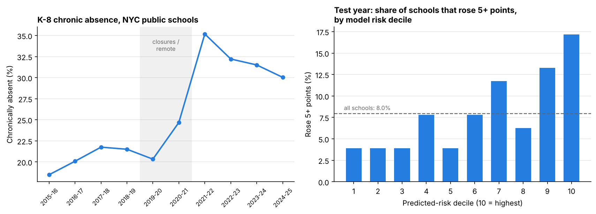

# Study 2 — Early warning for rising chronic absence

## Summary

| | |
|---|---|
| **Question** | Can we tell, at the end of a school year, which elementary and middle schools' chronic absence will rise next year, early enough to send attendance support? |
| **Data** | NYC DOE School Quality Reports, 2015-16 to 2024-25: ~1,300 K-8 schools a year, 7,532 school-year transitions after exclusions |
| **Method** | Predict next year's rate from what's known at year-end (this year's rate, last year's change, attendance, size, school type, district, Economic Need Index, temporary-housing share). Gradient boosting vs two baselines. Train 2015–18 and 2021–22, tune on 2022→23, test **once** on 2023-24 → 2024-25. |
| **Result** | Next year's rate is mostly this year's: the model's average error (**3.83 points**) is only slightly better than "same as this year" (3.93). But it does find risers: among its **top 10% riskiest schools, 17.2% rose 5+ points, 2.2× the 8.0% base rate** (AUC 0.65). A mean-reversion line can't do this (AUC 0.50). |
| **Takeaway** | School absence is very persistent, so the value isn't in forecasting levels. It's in a short, ranked watch list where attendance outreach is about twice as likely to be needed. The strongest signals are this year's level, last year's change, the district and economic need. |



**The citywide picture.** K-8 chronic absence rose from **18.5%** in 2015-16 to a peak
of **35.2%** in 2021-22, the first full year back in person, and has fallen every year
since, to **30.0%** in 2024-25. It's still well above pre-pandemic levels.

## Details

**No look-ahead.** Every feature is known at the end of year *t*. Economic Need Index
(2021-22) and temporary-housing share (2020-21) are the latest school-level releases and
are treated as fixed school characteristics. Transitions touching 2019-20 (closures
from March 2020) or 2020-21 (remote learning) are excluded, because attendance in those
years isn't comparable. The number of boosting rounds was chosen on the validation year;
the test year was scored once.

**Test year (2023-24 → 2024-25, 1,280 schools).**

| Model | Mean abs. error | Rise ≥5 pts: AUC | Precision in top 10% |
|---|---|---|---|
| Same as this year | 3.93 pts | 0.50 | (no ranking) |
| Mean reversion (linear) | 3.85 pts | 0.50 | 8.6% |
| **Gradient boosting** | **3.83 pts** | **0.65** | **17.2%** |

Base rate: 8.0% of schools rose 5+ points. On average, schools improved 1.2 points that year.

**Which features matter** (validation error increase when a feature is dropped, in
points): this year's rate 0.22, last year's change 0.14, district 0.09, Economic Need
Index 0.08, borough 0.04. Attendance rate and school size add nothing beyond these.

**Data-quality exclusion.** 53 school-years reported under 1% chronic absence, 40 of
them at charter schools. NYC's lowest-absence schools sit around 3–5%, so these are
treated as reporting errors and excluded. Left in, they topped the watch list as
"certain" rebounds.

## Watch list for 2025-26

`watch_list_2025_26.csv` scores all 1,307 K-8 schools from their 2024-25 data, using a
model refit on every usable year. It ranks schools by predicted change. The list is a
prompt for a conversation, not a verdict: about 4 in 5 schools in the top decile
**won't** rise 5+ points, and the biggest predicted rises are mostly schools that
improved sharply last year and tend to slip back.

## Files

- `run.py`: builds the panel, trains, validates, tests, writes the watch list and chart
- `results.json`: all metrics
- `watch_list_2025_26.csv`: school-level risk scores for next year

```bash
python build.py                                     # once, from the repo root
python studies/02_absence_early_warning/run.py
```
