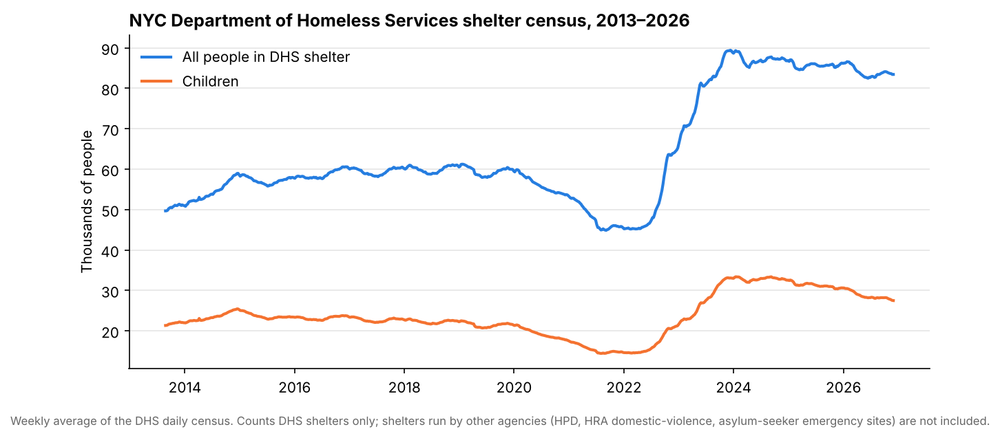
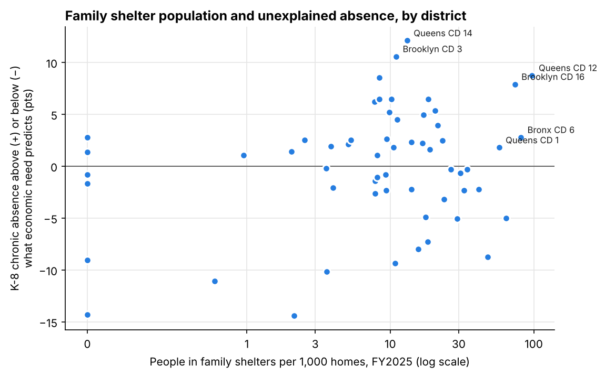

# Study 4 — NYC's shelter population and its schools

## Summary

| | |
|---|---|
| **Question** | The main analysis found that a school's share of students in temporary housing predicts chronic absence beyond poverty. How has the shelter population changed since then, where do sheltered families live now, and do those districts have more unexplained absence? |
| **Data** | DHS daily shelter census, Aug 2013 – Nov 2026 (two NYC Open Data files combined); monthly DHS census by community district and facility type, Jul 2018 – Oct 2026; district outcomes from the main build |
| **Method** | Citywide trend; FY2025 average family-shelter population per district per 1,000 homes; comparison with FY2019; Spearman correlations and regressions against K-8 chronic absence and the "absence gap" (absence above what economic need predicts) |
| **Result** | The DHS census went from **~58,000 (mid-2019)** down to **~45,000 (2021-22)**, then up to a **peak of 89,558 (Dec 10, 2023)**; it's **83,426** now, including **27,493 children**. People in family shelters averaged **62,142** in FY2025, **+57%** on FY2019. Ten districts host **53%** of them. **Jamaica (Queens CD 12)** hosts the most: 8,295 people, 97 per 1,000 homes. Across all 59 districts, shelter population only **weakly** tracks unexplained absence (ρ = 0.15, p = 0.24). |
| **Takeaway** | Where shelters are isn't where sheltered students go to school: federal law (McKinney-Vento) lets students in temporary housing stay at their school of origin, so many commute. District shelter counts are a blunt proxy, and the school-level temporary-housing counts that showed the real effect are only public through 2020-21, when the census was near its low. Refreshing that file is the single most useful data request here. |



## Details

**Where family shelters are (FY2025 average, people in families with children):**

| District | People | Per 1,000 homes | K-8 chronic absence | Absence gap |
|---|---|---|---|---|
| Queens CD 12 (Jamaica, St. Albans, Hollis) | 8,295 | 97 | 38.3% | **+8.7 pts** |
| Queens CD 1 (Astoria, Long Island City) | 5,521 | 57 | 30.9% | +1.8 |
| Brooklyn CD 16 (Brownsville, Ocean Hill) | 3,031 | 74 | 42.8% | **+7.9** |
| Bronx CD 6 (East Tremont, Belmont) | 2,992 | 81 | 39.8% | +2.8 |
| Manhattan CD 5 (Midtown) | 2,962 | 64 | 17.7% | −5.0 |

Jamaica and Brownsville stand out. Both host large family-shelter populations **and**
have absence well above what their schools' economic need predicts. Elsewhere the link
is loose: Midtown hosts nearly 3,000 sheltered family members but its schools are below
expectation, likely because those children attend schools elsewhere.



**Statistics (59 districts).** Family-shelter rate vs. 2020-21 temporary-housing share
of students: ρ = 0.54 (the two measures agree, as they should). Vs. K-8 chronic
absence: ρ = 0.42 (p = 0.001). Vs. the absence gap: ρ = 0.15 (p = 0.24). Regressing
chronic absence on economic need plus log shelter rate gives a shelter coefficient of
+0.014 (p = 0.07). It's suggestive, but not conclusive at the district level.

**The Rockaways again.** Queens CD 14 hosts 662 people in family shelters (13 per
1,000 homes, 26th of 59), so shelter placement doesn't explain its +12-point absence gap
either. Together with Study 1 (buses explain ~0.3 points of it), the Rockaways gap
remains open, which makes it the best target for a closer, school-by-school look.

**Scope.** The DHS census covers DHS-run shelters only. Shelters run by HPD, HRA
domestic-violence programs and asylum-seeker emergency sites aren't included, so the true
number of people in city shelter is higher. Blank cells in the district file are
treated as zero, since DHS leaves a facility-type column blank when a district has none.

## Files

- `run.py`: pulls both census files, builds the district table, models and charts
- `results.json`: all numbers above
- `district_shelter.csv`: FY2019 and FY2025 family-shelter population by district, with school outcomes

```bash
python build.py                                      # once, from the repo root
python studies/04_shelter_and_schools/run.py
```
