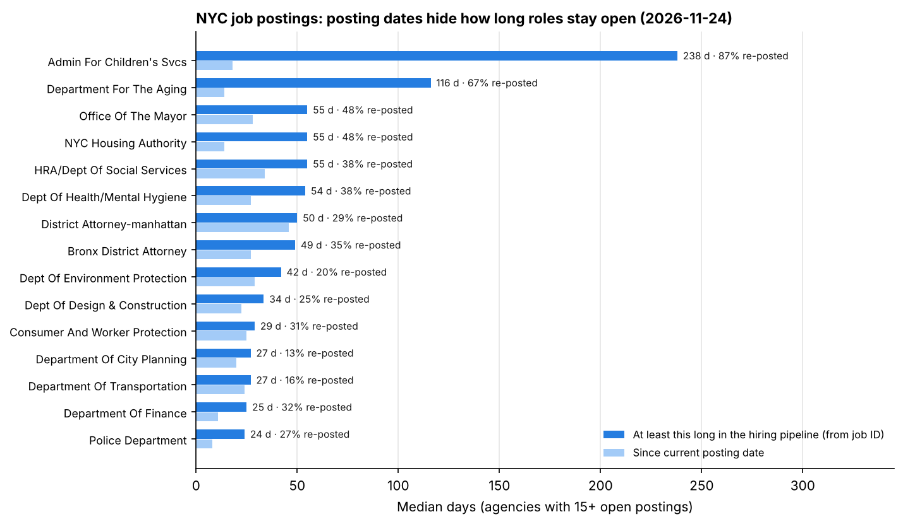

# Study 5 — How long do NYC government jobs stay open?

## Summary

| | |
|---|---|
| **Question** | How long do City of New York job openings stay unfilled, and which agencies and roles struggle most to hire? |
| **Data** | Jobs NYC Postings (NYC Open Data `kpav-sd4t`): 1,382 open jobs, 3,909 positions, snapshot of Nov 24, 2026 |
| **Method** | Age of each open posting; a **lower bound on how long each job has really been open**, recovered from the order of job IDs; and a monthly snapshot history (`data/snapshots/`) that will measure true time-to-fill as postings close |
| **Result** | Posting dates make hiring look fast: the median open posting is **25 days** old, and 99% are under 60. But **31% are re-posts** of jobs created at least a month earlier. By job ID, the median job has been open **at least 41 days**, and **20% at least 90 days**. **Administration for Children's Services** is the outlier: 87% of its postings are re-posts, open a median of **238+ days**. Lower-paid roles (under $60k) have been open longest (47+ days vs 39+ for $130k+). |
| **Takeaway** | Re-posting resets the visible date, so posting age understates how hard roles are to fill. Tracking job IDs across monthly snapshots gives real time-to-fill on actual city postings, replacing the simulated hiring data in the talent-acquisition project. |



## Details

**Why posting dates mislead.** The feed shows postings dated within roughly the last
60 days. Older jobs come back with a new posting date but the same job ID. Job 595362
(an HRA case management supervisor) carries a posting date of Nov 23, 2026, yet job
774325, a much higher ID, was already posted on March 17, 2026, so 595362 has existed
since at least March.

**The job-ID bound.** IDs are assigned in sequence. If a job was posted on date *d*,
every job with a lower ID already existed on *d*. So for each month-end *m*, any job
with an ID at or below the highest ID posted by *m* existed by *m*. That gives each
job an "existed by" date and a minimum number of days it has been in the pipeline.
It's a **lower bound**: the real time is the same or longer. A job counts as a re-post
when that date is more than a month before its current posting date.

**By agency** (15+ open postings), longest-running at the top:

| Agency | Open postings | Median days since posted | Median days in pipeline (at least) | Re-posted |
|---|---|---|---|---|
| Admin. for Children's Services | 15 | 18 | **238** | 87% |
| Department for the Aging | 21 | 14 | **116** | 67% |
| Office of the Mayor | 67 | 28 | 55 | 48% |
| NYC Housing Authority | 44 | 14 | 55 | 48% |
| HRA / Social Services | 79 | 34 | 55 | 38% |
| Health & Mental Hygiene | 266 | 27 | 54 | 38% |

Fastest: Parks (11 days), Correction (17), HPD (18), Comptroller (22).

**By job category:** social services, health, communications and HR roles have been
open longest (median 54–55+ days); finance (27) and technology (32.5) the shortest.
Social services has the highest share open 180+ days (24%).

## Time-to-fill, going forward

Each run saves `data/snapshots/job_postings_<date>.csv.gz`, and the monthly GitHub
Actions refresh runs this study. When a job ID disappears between snapshots it's
counted as closed, and its time open (last seen − posting date, plus the job-ID
bound) goes into `closed_postings.csv`. After a few months that's real time-to-fill
by agency and title, built entirely from public data.

**Caveats.** A closed posting may have been filled or cancelled; the feed doesn't say
which. Posting dates and IDs describe the public listing, not internal requisition
dates.

## Files

- `run.py`: fetches postings, saves the snapshot, computes ages and the job-ID bound, writes results and chart
- `results.json`, `postings_by_agency.csv`
- `../../data/snapshots/`: the growing monthly history

```bash
python studies/05_city_job_postings/run.py
```
