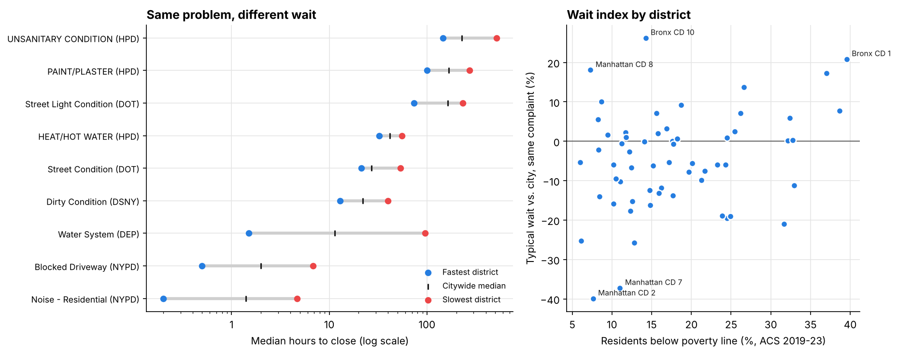

# Study 6 — Same problem, different wait: 311 response times by neighborhood

## Summary

| | |
|---|---|
| **Question** | When New Yorkers report the same problem to 311, do people in poorer neighborhoods wait longer for the city to close it? |
| **Data** | 1.28 million FY2025 311 requests (Jul 2024 – Jun 2025) across 9 complaint types and 5 agencies (HPD, NYPD, DEP, DOT, DSNY); neighborhood poverty (ACS 2019-23) from the NYC Health Department's Environment & Health Data Portal |
| **Method** | Hours from request to closure. Each district is compared with the **citywide median for the same complaint type**, never across types. Per-type correlations; a pooled within-type model weighted by volume, with errors clustered by district, run with and without borough controls |
| **Result** | Citywide, every 10 points of poverty goes with **7.6% longer waits** for the same complaint (95% CI 2.2–13.3%, p = 0.006). But within a borough the gap disappears (−3.9%, p = 0.29): it's mostly **Manhattan being fast** (19% faster than typical) and **the Bronx being slow** (7% slower). The clearest single gaps are **DEP water-system** complaints (district medians from 1.5 to 95 hours; ρ = 0.49 with poverty) and **DOT street conditions** (21 to 54 hours; ρ = 0.34). HPD's housing complaints show **no** poverty gap; heat complaints close slightly *faster* in poorer districts. |
| **Takeaway** | Response-time differences track boroughs and agencies more than neighborhood income. That points to borough-level operations (crews, depots, staffing) for DEP and DOT as the place to look. |



## Details

**Slowest districts** (median wait vs. the city for the same complaints): Bronx CD 10
(Throgs Neck, Co-op City, +26%), Bronx CD 1 (Mott Haven, +21%), Manhattan CD 8 (Upper
East Side, +18%), Bronx CD 3 (Morrisania, +17%), Bronx CD 7 (Fordham, +14%).
**Fastest:** Manhattan CD 2 (Greenwich Village, −40%), CD 7 (Upper West Side, −37%),
CD 5 (Midtown, −26%), CD 1 (Tribeca, −25%), CD 11 (East Harlem, −21%). East Harlem is
one of the city's poorer districts and among its fastest-served, and the Upper East
Side is one of its richest and among its slowest. That's why the district-level
correlation with poverty is weak (ρ = 0.20, p = 0.12).

**By complaint type** (Spearman ρ between district poverty and district median wait):

| Complaint (agency) | Citywide median | Fastest → slowest district | ρ with poverty |
|---|---|---|---|
| Water System (DEP) | 11.4 h | 1.5 → 95.2 h | **0.49** (p < 0.001) |
| Street Condition (DOT) | 27.1 h | 21.2 → 53.7 h | **0.34** (p = 0.009) |
| Noise – Residential (NYPD) | 1.4 h | 0.2 → 4.7 h | 0.24 (p = 0.07) |
| Street Light (DOT) | 163 h | 74 → 233 h | 0.19 |
| Blocked Driveway (NYPD) | 2.0 h | 0.5 → 6.8 h | 0.19 |
| Dirty Condition (DSNY) | 22.1 h | 12.9 → 39.7 h | 0.17 |
| Paint/Plaster (HPD) | 167 h | 100 → 272 h | 0.05 |
| Unsanitary Condition (HPD) | 226 h | 147 → 515 h | −0.19 |
| Heat/Hot Water (HPD) | 41.8 h | 32.6 → 55.5 h | −0.24 (p = 0.07) |

**"Closed" isn't always "fixed."** Two rules keep the comparison honest:
- **Rodent complaints were dropped:** 59% close within a minute, because the Health
  Department closes the request when it routes it to inspection.
- **Requests closed within one minute of opening are excluded** from every type. These are
  closures at intake (duplicates, referrals, no access), mostly DEP water-system
  (15,954) and NYPD noise and DOT street condition (~3,200 each).

Requests with no community district (mostly street-level DOT complaints), still open,
or closed before they were opened are also excluded and counted in `results.json`.

**Limitations.** Closure time is an administrative measure. For NYPD complaints it
records when officers closed the call, not whether the noise stopped. The comparison
covers 9 complaint types; others may differ. This is association, not proof of
unequal treatment.

## Files

- `run.py`: downloads the requests (cached in `data/raw/311/`), computes waits, models, chart
- `results.json`, `district_by_type.csv`, `district_wait_index.csv`

```bash
python studies/06_311_response_equity/run.py
```
