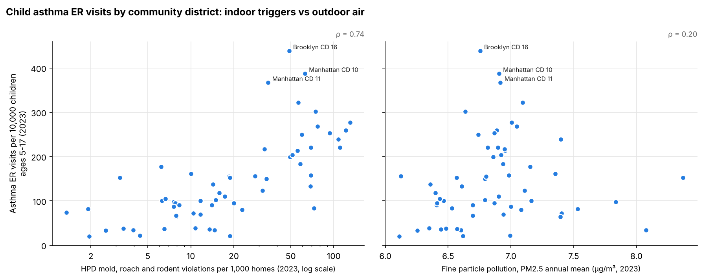

# Study 7 — Children's asthma and the homes they live in

## Summary

| | |
|---|---|
| **Question** | Why do some NYC neighborhoods send far more children to the ER for asthma? Is it poverty, outdoor air pollution, or conditions inside the home? |
| **Data** | All by community district: child asthma ER visits and hospitalizations, 2023 (NYC Health Department, Environment & Health Data Portal); **108,016 HPD violations for mold, roaches and rodents** issued in 2023; PM2.5 air pollution, 2023 (NYC Community Air Survey); poverty and homes built before 1950, ACS 2019-23; K-8 chronic absence, 2024-25 |
| **Method** | Asthma-trigger violations per 1,000 homes; Spearman correlations; a regression of (log) child asthma ER rates on trigger violations, poverty, PM2.5 and old housing together, with robust standard errors; a second model linking asthma to chronic absence |
| **Result** | Child asthma ER visits range **21-fold**, from 20 per 10,000 children (Tottenville, SI) to **438** in Brownsville; the citywide rate is 139. Mold, roach and rodent violations track it closely (ρ = **0.74**). In the joint model each standard deviation more of those violations goes with **86% more ER visits** (95% CI +33% to +161%, p < 0.001), and **poverty adds nothing** once they're included. Outdoor PM2.5 adds a smaller **+25%** per SD (p = 0.02). Districts with more child asthma also have more chronically absent K-8 students: **+4.6 points per SD**, beyond poverty (p < 0.001). |
| **Takeaway** | Neighborhood poverty predicts asthma largely **through housing conditions**. Indoor allergen hazards are the measurable, fixable link, and enforcement under NYC's Asthma-Free Housing Act (Local Law 55) is aimed at exactly that. The asthma–absence link connects this to the school findings elsewhere in the repo. |



## Details

**Highest child asthma ER rates (per 10,000 ages 5–17, 2023):**

| District | ER visits | Trigger violations / 1,000 homes | Poverty |
|---|---|---|---|
| Brooklyn CD 16 (Brownsville) | 438 | 49 | 33% |
| Manhattan CD 10 (Central Harlem) | 387 | 63 | 24% |
| Manhattan CD 11 (East Harlem) | 367 | 35 | 32% |
| Bronx CD 1 (Mott Haven) | 322 | 57 | 40% |
| Brooklyn CD 17 (East Flatbush) | 302 | 75 | 16% |
| Bronx CD 6 (East Tremont) | 277 | **130** | 39% |

**Lowest:** Tottenville (20), Borough Park (21), Upper East Side (22), New Springville
(33), Greenwich Village (34). Borough Park is the instructive exception: 25% of
residents are below the poverty line, but it has few trigger violations (19 per 1,000)
and one of the lowest asthma rates in the city.

**Model** (59 districts, log child asthma ER rate, all predictors standardized, HC3
robust errors): trigger violations +86% per SD (p < 0.001); PM2.5 +25% (p = 0.02);
poverty −0.2% (p = 0.99); very old homes −17% (p = 0.09). R² = 0.63, against 0.44 for
poverty alone. The share of homes built before 1950 has little to do with asthma; what
matters is whether the building has mold and pests now.

**Measuring triggers.** HPD order numbers 550, 553 and 853 (mold), 566, 568 and 868
(roaches and vermin), and 567, 569, 867 and 869 (mice and rats), checked against the
violation text. In 2023: 39,635 mold, 36,821 roach and 31,560 rodent violations.

**Limitations.**
- **Ecological.** District-level patterns can't show that a specific child's asthma
  came from a specific apartment.
- **Violations measure enforcement as well as conditions.** They depend on tenants
  calling 311 and on inspections. That bias usually *under*-counts problems in
  neighborhoods where people are less likely to complain, so it's more likely to
  weaken this relationship than create it.
- **Collinearity.** Triggers and poverty move together (ρ ≈ 0.7). The model separates
  them as far as 59 districts allow, but they can't be fully disentangled.
- **Timing.** The absence measure (2024-25) is two years after the asthma data (2023).

## Files

- `run.py`: pulls Health Department indicators, HPD violations and air quality; models; chart
- `results.json`, `district_asthma_housing.csv`

```bash
python build.py                                  # once, from the repo root
python studies/07_asthma_and_housing/run.py
```
