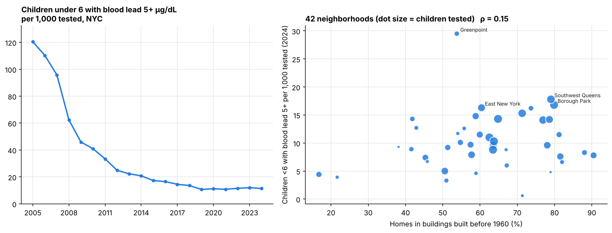

# Study 9 — Children's seizures and their environment

> **How this study is designed, and why.** No public dataset follows an individual
> child's seizures to their apartment, wall paint or school; that's protected health
> information. So this study works in two parts. **Part A (real data, done)** maps
> children's environmental exposure to lead (the best-documented environmental cause
> of seizures) alongside building age, lead-paint hazards and school outcomes for all
> 42 NYC health neighborhoods. **Part B (pipeline built and verified, real run
> pending)** measures pediatric seizure hospitalizations by borough from the state's
> SPARCS discharge file. Both parts describe neighborhood patterns, **not causes for
> any individual child**.
>
> **Medical context.** At very high blood levels, lead causes lead encephalopathy, which
> can include seizures. At the much lower levels seen in NYC children today it's
> linked mainly to learning, attention and behavior problems. Most childhood seizures
> have other causes, such as fevers (febrile seizures), epilepsy, infections and head
> injuries. Anyone worried about a specific child should talk to a pediatrician.

## Summary

| | |
|---|---|
| **Question** | Where are NYC children most exposed to lead (old paint, old buildings, lead hazards), how does that line up with their schools, and where are pediatric seizure hospitalizations highest? |
| **Data** | Part A: elevated blood lead in children under 6, 2005–2024 (NYC Health Department); **3.7 million homes** in PLUTO tax lots by year built; **20,442 HPD lead-paint hazard violations** in FY2025 (peeling or deteriorated lead paint); poverty (ACS 2019-23); K-8 chronic absence 2024-25 and students-with-disabilities share. Everything is placed in the 42 Health Department neighborhoods by coordinates. Part B: SPARCS inpatient stays, ages 0–17 |
| **Method** | Neighborhood correlations and a joint model of child lead rates on old housing, lead-paint violations and poverty. Part B: seizure-related stays (diagnosis group mentioning seizure, epilepsy or convulsion) by borough of residence, with length of stay, severity, payer and race/ethnicity |
| **Result (Part A)** | Childhood lead poisoning fell **more than 90%**: from 120 per 1,000 children tested in 2005 (**37,344 children**) to 11.4 in 2024 (**2,600 children**). It has been flat since 2019. Rates are highest in **Greenpoint (29.5 per 1,000)**, Southwest Queens (17.8), Borough Park (16.8), East New York (16.3) and Central Harlem (16.2), and lowest in Bayside–Little Neck (0.6). Neighborhoods with more lead-paint violations per older home (ρ = 0.38, p = 0.01), more pre-1950 housing (ρ = 0.36) and more poverty (ρ = 0.42) have higher rates, and **they also have more chronically absent K-8 students (ρ = 0.55, p < 0.001)**. Building age alone predicts little: Bayside is 71% pre-1960 homes and has the city's lowest rate. |
| **Takeaway** | Old buildings matter where their paint is **failing**, which is what HPD's lead-hazard violations capture. Because 63% of NYC homes are in pre-1960 buildings, building age by itself isn't a useful screen. The highest-lead neighborhoods are also where schools struggle most with attendance, which fits lead's known effects on learning but can't separate lead from poverty at this scale. |



## Part A details

**Highest childhood lead rates, 2024** (children under 6 with blood lead 5+ µg/dL per
1,000 tested):

| Neighborhood | Rate | Children tested | Homes pre-1960 | Lead-paint violations per 1,000 older homes | Poverty |
|---|---|---|---|---|---|
| Greenpoint | **29.5** | 3,500 | 54% | 1.7 | 17% |
| Southwest Queens | 17.8 | 8,800 | 79% | 3.8 | 11% |
| Borough Park | 16.8 | 12,500 | 80% | 10.1 | 22% |
| East New York | 16.3 | 7,600 | 60% | 6.5 | 23% |
| Central Harlem–Morningside Hts | 16.2 | 3,800 | 74% | 9.1 | 25% |
| Bedford-Stuyvesant–Crown Heights | 15.3 | 8,700 | 71% | 9.3 | 23% |

Greenpoint stands out: it has the highest rate with relatively few lead-paint
violations. The Health Department has documented non-paint lead sources in NYC
(some imported spices, cosmetics, ceramics and health remedies; see NYC Open Data
`da9u-wz3r`). A gap like this is where those, or unreported paint hazards, would be
worth investigating.

**Joint model** (42 neighborhoods, robust errors): pre-1960 share, poverty and
lead-paint violations together explain only 10% of the variation, and none is
individually significant. They overlap heavily, and 42 neighborhoods is a small sample.
The individual correlations above are the more informative result.

**Lead-hazard violations.** HPD order numbers 616, 617 and 624: paint that tested
positive for lead or is presumed lead (pre-1960 buildings, under NYC Local Law 1) and is
peeling or on a deteriorated surface. Paperwork violations (618, 619, 622, 623) are
excluded.

## Part B — pediatric seizure hospitalizations (run it)

`seizures_sparcs.py` uses the same SPARCS file as Studies 3 and 8:

```bash
python studies/09_child_seizures_environment/seizures_sparcs.py --data path/to/Hospital_Inpatient_Discharges.csv
```

It keeps NYC children (ages 0–17, newborn admissions excluded, residence from the
3-digit ZIP), flags stays whose principal diagnosis group mentions seizure, epilepsy
or convulsion, and reports for each borough: seizure stays, their share of all
pediatric stays, length of stay, ER admission share, Medicaid share, and the borough's
child lead rate from Part A, plus breakdowns by race, ethnicity and payer. Results
go to `results_sparcs/`.

**Verified on synthetic data** where Bronx children were given twice the seizure share:
the module reports 8.0% in the Bronx vs about 4% elsewhere, and correctly excludes
ZIP prefix 110 (mostly Nassau County). `tests/test_studies.py` reruns this check.

**Limits of the public file.** No patient ID, so repeat admissions of one child
can't be linked; location is only the 3-digit ZIP (about a borough); and the diagnosis
group doesn't say what caused a seizure. Borough-level patterns are as far as public
data can go. Anything finer needs SPARCS limited or identifiable data, which requires
an approved research application to the state.

## Files

- `run.py`: Part A (real data): lead, housing, violations, schools by neighborhood; chart
- `seizures_sparcs.py`: Part B: pediatric seizure stays by borough from SPARCS
- `results.json`, `neighborhood_lead_profile.csv`

```bash
python build.py                                            # once, from the repo root
python studies/09_child_seizures_environment/run.py
```
